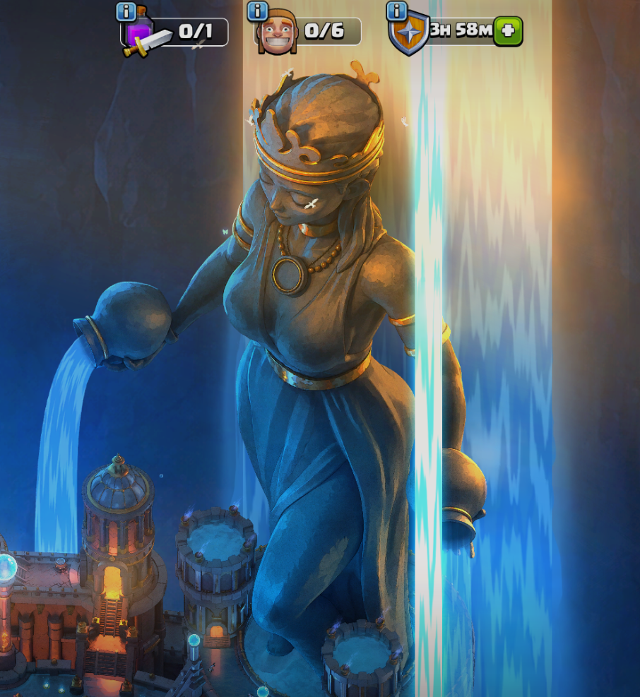

# vitepress-image-viewer 

VitePress image viewer with zoom, drag, fullscreen overlay, captions and download button. Automatically enhances all images on the page. Built with Vue 3. ✨ 

  
  


## Installation

```sh [npm]
npm i @belikellwyd/vitepress-image-viewer
```

## Usage ❤️

### Configuration

```typescript  [docs/.vitepress/theme/index.ts]
import type { Theme } from 'vitepress'
import DefaultTheme from 'vitepress/theme'

import ImageViewerP from '@belikellwyd/vitepress-image-viewer' //[!code ++]
import '@belikellwyd/vitepress-image-viewer/style.css' //[!code ++]

export default {
  extends: DefaultTheme,
  enhanceApp(ctx) {
    ImageViewerP(ctx.app) //[!code ++]
  }
}
```

### Advanced configuration

- ```transparentBg?: boolean``` - Use transparent dark overlay instead of solid background. Default is true.

- ```autoShowThumbnails?: boolean``` - Automatically show thumbnails on desktop. Default is true.

- ```ignoreLinkedImages?: boolean``` - Ignore images wrapped in links. Default is true.

- ```exclude?: { classes?: string[], fileNames?: string[] }``` - Disable the viewer by a class on the image or any ancestor, or by file name.

- ```include?: { classes?: string[], fileNames?: string[] }``` - Re-enable matching images. It takes priority over custom and built-in exclusions.

Linked images, the VitePress navigation logo (`.VPNavBarTitle .VPImage.logo`), home hero image (`.VPHero.VPHomeHero .image-bg`) and images with the `link-card-logo` class are excluded by default. To enable them again, set `ignoreLinkedImages` to `false` or add a matching class or file name to `include`.

```typescript [docs/.vitepress/theme/index.ts]
import type { Theme } from 'vitepress'
import DefaultTheme from 'vitepress/theme'

import ImageViewerP from '@belikellwyd/vitepress-image-viewer' //[!code ++]
import '@belikellwyd/vitepress-image-viewer/style.css' //[!code ++]

export default {
  extends: DefaultTheme,
  enhanceApp(ctx) { 
    ImageViewerP(ctx.app, { //[!code ++]
      transparentBg: false, //[!code ++] default is true
      autoShowThumbnails: false, //[!code ++] default is true
      ignoreLinkedImages: true, //[!code ++] default is true
      exclude: { //[!code ++]
        classes: ['image-viewer-disabled'], //[!code ++]
        fileNames: ['avatar.png'] //[!code ++]
      }, //[!code ++]
      // Uncomment a class to restore a built-in exclusion.
      include: { classes: [], fileNames: [] } //[!code ++]
    }) //[!code ++]
  }
}
```

## Examples

### Markdown Image

**Input:**

```md [example.md]

```

**Output:**


### HTML Image

**Input:**

```html [example.md]

```

**Output:**

<p align="center">
  
</p>

### Image using the Image Group plugin

<br/>

<Card title="@belikellwyd/vitepress-image-group" link="https://www.npmjs.com/package/@belikellwyd/vitepress-image-group" />

**Input:**

```vue
<ImageGroup
  :sources="[
    'demo-4.jpg'
  ]"
  type="manual"
  width="400px"
  caption="Japanese Waterfall."
/>
```

**Output:**

<ImageGroup
  :sources="[
    'demo-4.jpg'
  ]"
  type="manual"
  width="400px"
  caption="Japanese Waterfall."
/>

### Linked image

Images wrapped in links keep their normal navigation behavior and do not open the viewer by default.

**Input:**

```html [example.md]
<a href="https://github.com/belikellwyd/vitepress-image-viewer">
  
</a>
```

**Output:**

<a href="https://github.com/belikellwyd/vitepress-image-viewer" target="_blank" rel="noreferrer">
  <ImageGroup
    :sources="[
      'demo-5.png'
    ]"
    type="manual"
    width="400px"
    caption="Link to github page."
  />
</a>
